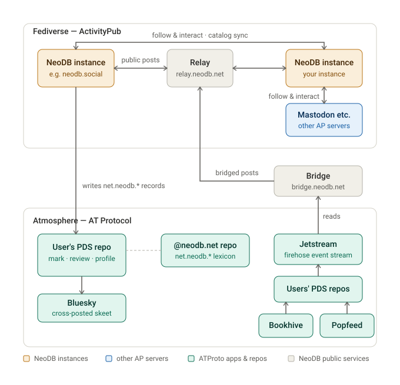

# ActivityPub Federation

NeoDB federates over ActivityPub (server-to-server). The implementation is based
on [Takahē](https://jointakahe.org), extended so that NeoDB instances can
exchange catalog, list and review data on top of ordinary Fediverse posts.
General ActivityPub servers can consume those posts as plain `Note` / `Article`
objects and ignore the NeoDB-specific extensions; NeoDB peers read the extensions
to reconstruct the underlying marks, ratings, reviews and lists.

For NeoDB's ATProto (Bluesky) behaviour, see [atproto.md](atproto.md).

## Federation topology

How NeoDB instances interconnect with each other, the Fediverse, and the Atmosphere:



## Supported protocols and standards

- [ActivityPub](https://www.w3.org/TR/activitypub/) (server-to-server)
- [WebFinger](https://webfinger.net/)
- [HTTP Signatures](https://datatracker.ietf.org/doc/html/draft-cavage-http-signatures)
- [NodeInfo](https://nodeinfo.diaspora.software/)

## Supported FEPs

- [FEP-f1d5: NodeInfo in Fediverse Software](https://codeberg.org/fediverse/fep/src/branch/main/fep/f1d5/fep-f1d5.md)

## NodeInfo

A NeoDB instance can be identified from its user agent string
(`NeoDB/x.x (+https://example.org)`) and the `protocols` array in its NodeInfo,
e.g. <https://neodb.social/nodeinfo/2.0/>:

```json
{
  "version": "2.0",
  "software": {
    "name": "neodb",
    "version": "0.10.4.13",
    "repository": "https://github.com/neodb-social/neodb",
    "homepage": "https://neodb.net/"
  },
  "protocols": ["activitypub", "neodb"],
  "metadata": {
    "nodeEnvironment": "production",
    "neodbFeatures": ["catalog.search"],
    "neodbFeatureParams": {
      "catalog.search": {"endpoint": "https://neodb.social/api/catalog/search"}
    }
  }
}
```

A NeoDB instance treats a domain as a NeoDB peer when its NodeInfo has `neodb`
in `protocols` and `nodeEnvironment` of `production`.

### Features

`metadata.neodbFeatures` lists the NeoDB features a server offers to peers;
`metadata.neodbFeatureParams` holds their parameters, keyed by token. A server
offers exactly what it lists: no list, or `[]`, means none. Tokens are
lowercase dotted strings whose meaning never changes; unknown tokens are
ignored.

| Token | Meaning |
|---|---|
| `catalog.search` | Peers may send catalog searches to `neodbFeatureParams["catalog.search"].endpoint` (default `https://<domain>/api/catalog/search`; used only when it is `https` on the server's domain or a subdomain) with the request and response shape of `/api/catalog/search`: `query`, `page` (20 items per page) and optional `category`; `data` is a list of items with `url` (a path on the server's domain), `display_title`, `brief`, `cover_image_url` and `external_resources` (a list). NeoDB advertises it unless *Allow incoming federated search* is off, or the instance runs in debug or without federation; it searches only peers that advertise it. |

## Extended activities

NeoDB adds two fields to the `Note` activity (and to `Article`, which carries
reviews):

- `relatedWith` is a list of NeoDB-specific activities associated with the post.
  For each entry, `id` and `href` are unique links to that activity,
  `withRegardTo` links to the catalog item, `attributedTo` links to the user, and
  `type` is one of:
    - `Status` — `status` is one of `complete`, `progress`, `wishlist`, `dropped`
    - `Rating` — `value` is the grade (integer 1-10); `worst` is always 1, `best` always 10
    - `Comment` — `content` is the comment text
    - `Review` — `name` is the title, `content` the body, `mediaType` is `text/markdown` (see [Review](#review))
    - `Note` — `name` is the title, `content` the note text (older instances sent the title as `title`; it is still emitted alongside `name`, and readers accept either)
    - `Shelf` — the lightweight envelope of a Collection or Shelf (see [Collections and shelves](#collections-and-shelves))
- `tag` carries the catalog items referenced by the activity. Each item's `type`
  is one of `Edition`, `Movie`, `TVShow`, `TVSeason`, `TVEpisode`, `Album`,
  `Game`, `Podcast`, `PodcastEpisode`, `Performance`, `PerformanceProduction`,
  and `href` links to the item.

This is a pragmatic way to pass extra information between NeoDB instances; other
ActivityPub servers simply ignore it. Suggestions for improvement are welcome.

### Review

A review rides in a post of `type: Article`. The outer object carries `name`,
`content` (HTML), `source` (`{content, mediaType: text/markdown}`) and `summary`
for general AP clients; the full `Review` activity sits in `relatedWith[0]` with
the raw markdown body and `withRegardTo` for NeoDB peers.

### Example

A post from `neodb.social` carrying a `Status`, `Comment` and `Rating`:

```json
{
  "@context": ["https://www.w3.org/ns/activitystreams", {
    "blurhash": "toot:blurhash",
    "Emoji": "toot:Emoji",
    "focalPoint": {
      "@container": "@list",
      "@id": "toot:focalPoint"
    },
    "Hashtag": "as:Hashtag",
    "manuallyApprovesFollowers": "as:manuallyApprovesFollowers",
    "sensitive": "as:sensitive",
    "toot": "http://joinmastodon.org/ns#",
    "votersCount": "toot:votersCount",
    "featured": {
      "@id": "toot:featured",
      "@type": "@id"
    }
  }, "https://w3id.org/security/v1"],
  "id": "https://neodb.social/@april_long_face@neodb.social/posts/380919151408919488/",
  "type": "Note",
  "relatedWith": [{
    "id": "https://neodb.social/p/5oyF0qRx96mKKmVpFzHtMM",
    "type": "Status",
    "status": "complete",
    "withRegardTo": "https://neodb.social/movie/7hfF7d0aFMaqHpFjUpq4zR",
    "attributedTo": "https://neodb.social/@april_long_face@neodb.social/",
    "href": "https://neodb.social/p/5oyF0qRx96mKKmVpFzHtMM",
    "published": "2024-11-17T10:16:42.745240+00:00",
    "updated": "2024-11-17T10:16:42.750917+00:00"
  }, {
    "id": "https://neodb.social/p/47cJnbQTkbSSN2izLwQMjo",
    "type": "Comment",
    "withRegardTo": "https://neodb.social/movie/7hfF7d0aFMaqHpFjUpq4zR",
    "attributedTo": "https://neodb.social/@april_long_face@neodb.social/",
    "content": "Broadway cin\u00e9math\u00e8que, at least I laughed hard.",
    "href": "https://neodb.social/p/47cJnbQTkbSSN2izLwQMjo",
    "published": "2024-11-17T10:16:42.745240+00:00",
    "updated": "2024-11-17T10:16:42.777276+00:00"
  }, {
    "id": "https://neodb.social/p/3AyYu974qo6OU09AAsPweQ",
    "type": "Rating",
    "best": 10,
    "value": 7,
    "withRegardTo": "https://neodb.social/movie/7hfF7d0aFMaqHpFjUpq4zR",
    "worst": 1,
    "attributedTo": "https://neodb.social/@april_long_face@neodb.social/",
    "href": "https://neodb.social/p/3AyYu974qo6OU09AAsPweQ",
    "published": "2024-11-17T10:16:42.784220+00:00",
    "updated": "2024-11-17T10:16:42.786458+00:00"
  }],
  "attributedTo": "https://neodb.social/@april_long_face@neodb.social/",
  "content": "<p>\u770b\u8fc7 <a href=\"https://neodb.social/~neodb~/movie/7hfF7d0aFMaqHpFjUpq4zR\" rel=\"nofollow\">\u963f\u8bfa\u62c9</a> \ud83c\udf15\ud83c\udf15\ud83c\udf15\ud83c\udf17\ud83c\udf11  <br>Broadway cin\u00e9math\u00e8que, at least I laughed hard.</p><p><a href=\"https://neodb.social/tags/\u6211\u770b\u6211\u542c\u6211\u8bfb/\" class=\"mention hashtag\" rel=\"tag\">#\u6211\u770b\u6211\u542c\u6211\u8bfb</a></p>",
  "published": "2024-11-17T10:16:42.745Z",
  "sensitive": false,
  "tag": [{
    "type": "Hashtag",
    "href": "https://neodb.social/tags/\u6211\u770b\u6211\u542c\u6211\u8bfb/",
    "name": "#\u6211\u770b\u6211\u542c\u6211\u8bfb"
  }, {
    "type": "Movie",
    "href": "https://neodb.social/movie/7hfF7d0aFMaqHpFjUpq4zR",
    "image": "https://neodb.social/m/item/doubanmovie/2024/09/13/a30bf2f3-4f79-43ef-b22f-58ebc3fd8aae.jpg",
    "name": "Anora"
  }],
  "to": ["https://www.w3.org/ns/activitystreams#Public"],
  "updated": "2024-11-17T10:16:42.750Z",
  "url": "https://neodb.social/@april_long_face/posts/380919151408919488/"
}
```

## Collections and shelves

NeoDB has two kinds of item list:

- **Collection** — a user-curated list.
- **Shelf** — a per-status list: Wishlist, Progress, Complete or Dropped.

Both federate with the same wire shape, `type: "Shelf"`. The type is deliberately
not `Collection`, to avoid colliding with the ActivityStreams `Collection` type:
an AP-aware peer must not mistake a NeoDB list for a generic AS collection.

### Announcement and discovery

When a Collection is created or updated, NeoDB publishes a `Note` post whose
`relatedWith[0]` carries the lightweight `Shelf` envelope described below. Shelves
are not announced this way — the per-mark `Status` posts already cover that
activity — so they are discovered by following a user, fetching a shelf URL
directly, or pasting its link.

### Lightweight envelope

The envelope never inlines the member list; it exposes `totalItems` and
`first` / `last` links to a paginated items endpoint:

```json
{
  "id":           "https://server/collection/<uuid>",
  "type":         "Shelf",
  "name":         "<title or shelf label>",
  "content":      "<description in markdown, Collection only>",
  "mediaType":    "text/markdown",
  "attributedTo": "<actor uri>",
  "published":    "...",
  "updated":      "...",
  "totalItems":   <int>,
  "first":        "https://server/.../items?page=1",
  "last":         "https://server/.../items?page=K",

  "shelfType":    "wishlist|progress|complete|dropped",  // Shelf only
  "query":        "<search query>"                       // dynamic Collection only
}
```

`shelfType` distinguishes the two kinds: present means Shelf, absent means
Collection.

The envelope `id` is the human-facing URL and is not guaranteed to dereference as
ActivityPub. Only the items endpoint is guaranteed to serve
`application/activity+json`, so follow `first` / `next` there to read members.

### Items endpoint

Each list exposes `<id>/items` as a standard `OrderedCollection`:

- With no `?page` parameter it returns the collection envelope (`id`, `type`,
  `totalItems`, `first`, `last`).
- With `?page=N` it returns one `OrderedCollectionPage` (`id`, `partOf`,
  `orderedItems`, and `next` / `prev` where applicable).

```json
// <id>/items
{
  "id":         "https://server/collection/<uuid>/items",
  "type":       "OrderedCollection",
  "totalItems": <int>,
  "first":      "https://server/collection/<uuid>/items?page=1",
  "last":       "https://server/collection/<uuid>/items?page=K"
}

// <id>/items?page=2
{
  "id":           "https://server/collection/<uuid>/items?page=2",
  "type":         "OrderedCollectionPage",
  "partOf":       "https://server/collection/<uuid>/items",
  "next":         "https://server/collection/<uuid>/items?page=3",
  "prev":         "https://server/collection/<uuid>/items?page=1",
  "orderedItems": [ /* ShelfItem entries */ ]
}
```

Pages hold up to 100 entries; the total length is unbounded, so walk `next` until
it is absent.

### ShelfItem entries

Each `orderedItems` entry is a `ShelfItem`:

```json
{
  "type":         "ShelfItem",
  "withRegardTo": "https://server/book/<uuid>",  // catalog item, always present
  "post":         "https://server/@alice/123",   // Shelf only: the mark's Status post
  "commentText":  "..."                           // Collection only: per-item note
}
```

`withRegardTo` links to the catalog item; dereferencing it returns an AP catalog
object (`Edition`, `Movie`, `TVShow`, `Album`, ...). For shelves, `post` links to
the mark's `Status` post, letting a peer fetch the associated mark, rating,
comment and review in a single request without following the user first.

### Fetching

Requests to the items endpoint should be HTTP-signed. NeoDB signs its outbound
fetches as the instance actor, using the canonical form Takahē and Mastodon use:

- Algorithm `rsa-sha256`.
- Signed headers exactly `(request-target) host date`.
- `Date` required, within a 300-second skew window.
- GET only — no request body or digest.

Public lists are served to any caller, including unsigned requests.
Followers-only and private lists require a signature from an actor entitled to
see them.

### Interoperability notes

- **Follow the origin.** Dereference a list at its original `id` on the origin
  instance. NeoDB holds only possibly-stale mirrors of remote lists and does not
  re-serve them as ActivityPub.
- **Public lists only, for now.** Cross-instance member sync is reliable only for
  public lists; followers-only members do not yet round-trip between instances.
  The announcement Note still reaches followers, so the list is mirrored even
  when its members lag.
- **Not yet federated.** Tag lists and collaborative collections are local-only.
  The `post` link on `ShelfItem` entries is emitted but not yet consumed
  automatically on ingest.

## BookWyrm reviews

BookWyrm sends a review to non-BookWyrm servers as an `Article`. NeoDB keeps
the post in the timeline and also maps it to a remote Review and Rating on
the reviewed book:

- `inReplyToBook` names the BookWyrm Edition. NeoDB imports it as a catalog
  source (`IdType.BookWyrm`, the canonical `https://<host>/book/<n>` URL as id
  value). The edition's ISBN, Open Library and Goodreads ids are lookup ids, so
  the review lands on an existing item that shares one; only a book with no
  match creates a new Edition from BookWyrm's metadata.
- `rating`, 0.5 to 5 stars in halves, becomes a Rating of stars × 2. Its
  remote id is the review id plus `#rating`.
- `name` is the translated `Review of "<book>" (<n> stars): <headline>`.
  The headline becomes the Review title; when it is missing BookWyrm renders
  `None`, and NeoDB then uses the name without `: None`.
- A review marked `sensitive` adds the Rating only, because a Review has no
  content warning. The text stays on the post.
- Edits and deletes take the same path as other remote pieces.

Comments, quotations and rating-only statuses arrive as `Note` and are not
mapped. Takahe hands every remote `Article` to NeoDB, which maps only those
with `relatedWith` or `inReplyToBook`.

A BookWyrm book URL is fetched only from a known BookWyrm server: a peer domain
whose nodeinfo names `bookwyrm`, or the server of the review's own author,
which covers an instance whose nodeinfo NeoDB has not fetched yet. Servers in
secure mode get a GET signed by the instance actor when an anonymous GET is
refused. `FediverseInstance` (the remote NeoDB fallback) refuses BookWyrm hosts
and payloads without `category`, so a BookWyrm URL never becomes a `fedi`
resource. Pasting a BookWyrm book URL into "add from URL" imports it the same
way.

BookWyrm serves editions and works under the same `/book/<n>` path, so one
site handles both and picks the model from the fetched `type`. A Work becomes
a catalog Work, with its Open Library work id as lookup id. An Edition names
its Work as parent, so importing an edition also imports and links the work.
Reviews attach to editions only.

Reviews received before this mapping existed are still stored as posts. To
link them, run:

```
neodb-manage journal bookwyrm-reviews        # report only
neodb-manage journal bookwyrm-reviews --fix  # register servers, link reviews
```

It first registers the BookWyrm servers listed on [FediDB](https://fedidb.org)
as peer domains with a placeholder nodeinfo; takahe then fetches their real
nodeinfo. `--delay` sets the seconds between reviews (default 1), because some
instances refuse bursts.

## Relay

NeoDB instances may share public ratings and reviews through a default relay,
currently `https://relay.neodb.net`, which propagates public activities and
catalog information between instances. Instance operators can turn this off in
admin settings.
